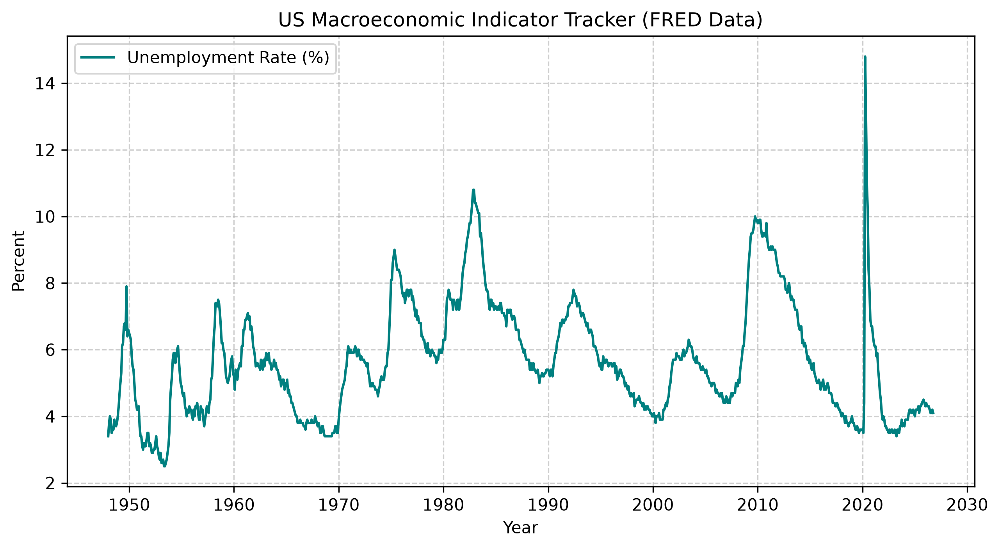

# FRED Macroeconomic Data Tracker

An end-to-end Python data application that programmatically fetches macroeconomic time-series indicators from the Federal Reserve Bank of St. Louis (FRED) API, processes the data using pandas, and generates visualization charts.

## Features
- Programmatically queries time-series data using the redapi library.
- Tracks key indicators: Unemployment Rate (UNRATE) and Consumer Price Index (CPIAUCSL).
- Generates automated data visualization charts.

## Output Visualization

---
*Notice: This product uses the FRED® API but is not endorsed or certified by the Federal Reserve Bank of St. Louis.*
